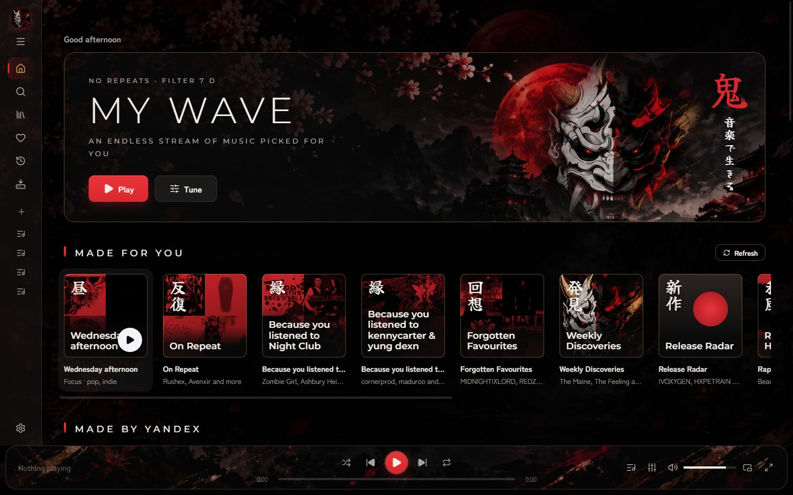
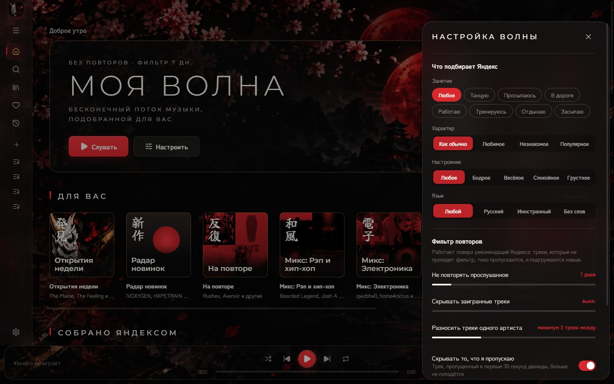
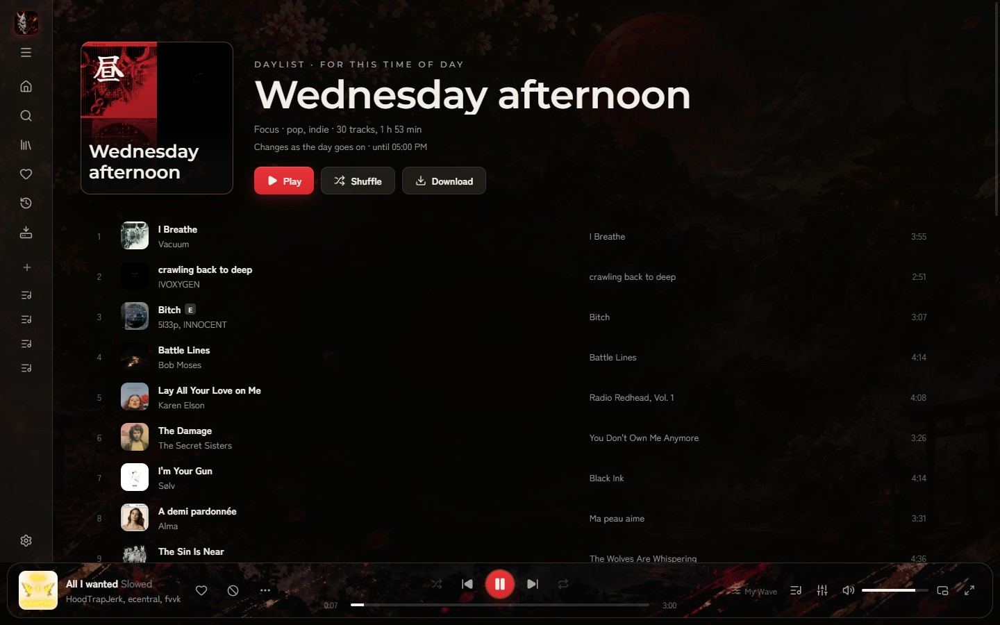
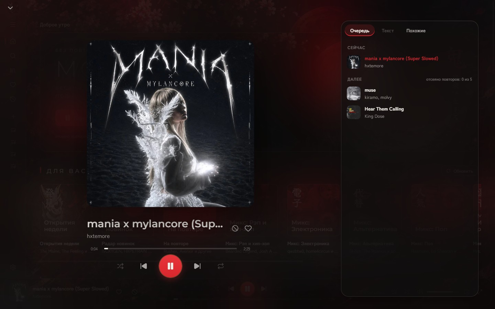
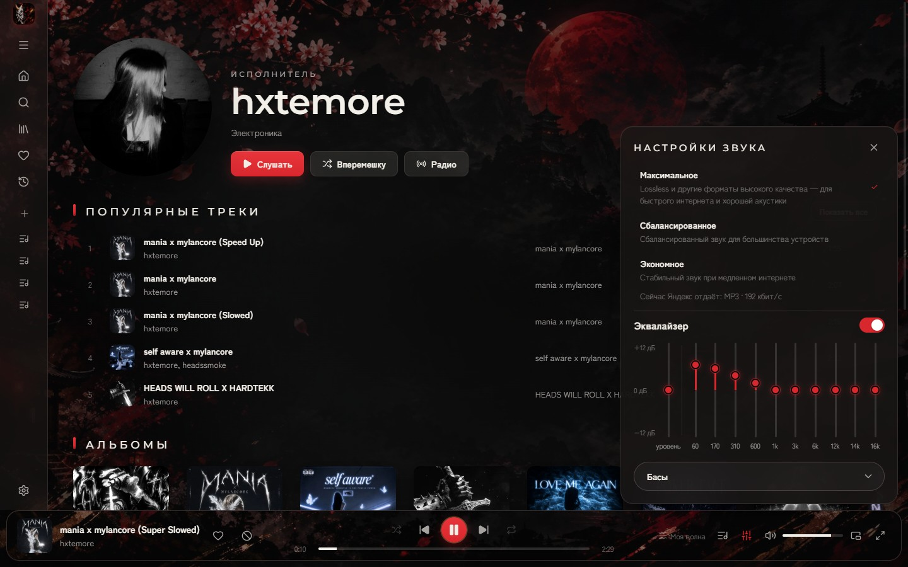
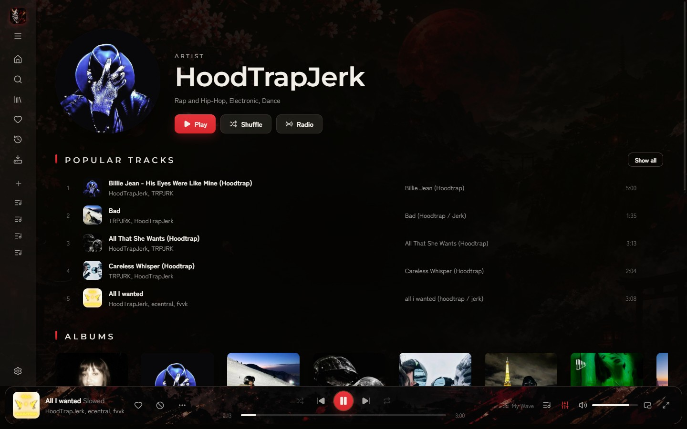

<div align="center">


# Oni

**Неофициальный клиент Яндекс Музыки для Windows и iPhone**<br>
Японский стиль, «Моя волна» без повторов и подборки в духе Spotify

<sub>鬼 · 音楽で生きる</sub>

<br>

[](https://github.com/D4SuCE/oni-releases/releases/latest)
[](https://github.com/D4SuCE/oni-releases/releases)
[](#установка)
[](#iphone)

### [⬇&nbsp; Скачать для Windows](https://github.com/D4SuCE/oni-releases/releases/latest) &nbsp;·&nbsp; [iPhone](#iphone)

<br>



</div>

<br>

## Что умеет

<table>
  <tr>
    <td width="50%" valign="top">
      
      <h3>Моя волна без повторов</h3>
      Занятие, характер, настроение и язык — как в Яндексе. Сверху — свой фильтр:
      не повторять прослушанное за последние дни, разносить треки одного артиста,
      скрывать то, что вы пропускаете.
    </td>
    <td width="50%" valign="top">
      
      <h3>Подборки в духе Spotify</h3>
      <b>Daylist</b> под время дня — утром бодрое, ночью тихое, меняется сам.
      «Открытия недели», «Радар новинок», «На повторе», «Забытые хиты»,
      «Потому что вы слушали…» и миксы по жанрам — собираются из ваших лайков
      и истории прослушиваний.
    </td>
  </tr>
  <tr>
    <td width="50%" valign="top">
      
      <h3>Сейчас играет</h3>
      Большая обложка, очередь, текст песни и похожие треки. Живые видеообложки
      Яндекса и пульсация обложек в такт музыке.
    </td>
    <td width="50%" valign="top">
      
      <h3>Звук</h3>
      Качество звука и 10-полосный эквалайзер с пресетами — «Басы», «Голос»,
      «Электроника» и ещё восемь, включая свой собственный.
    </td>
  </tr>
  <tr>
    <td width="50%" valign="top">
      
      <h3>Радио от чего угодно</h3>
      Бесконечный поток от трека, исполнителя, альбома или плейлиста —
      с тем же фильтром повторов, что и у волны.
    </td>
    <td width="50%" valign="top">
      
      <h3>Мини-плеер и Windows</h3>
      Маленькое окно поверх остальных, кнопки в превью на панели задач, значок
      в трее, боковые кнопки мыши для «назад / вперёд». Окно можно сделать
      полупрозрачным — сквозь него будет виден размытый рабочий стол.
    </td>
  </tr>
</table>

А ещё: поиск, коллекция и «Мне нравится», история со всех устройств, загрузка своих
mp3, интерфейс на русском и английском.

## Установка

1. Скачайте **`Oni-Setup-<версия>.exe`** со страницы
   [последнего выпуска](https://github.com/D4SuCE/oni-releases/releases/latest) и запустите.
2. Windows может показать «Система Windows защитила ваш компьютер» — нажмите
   **«Подробнее» → «Выполнить в любом случае»**. У программы нет платной цифровой
   подписи, поэтому SmartScreen её пока не знает.
3. Войдите через Яндекс — под **своим** аккаунтом. Для полных треков нужна подписка
   Яндекс Плюс.

Не хотите устанавливать — есть **`Oni-<версия>-portable.exe`**: один файл, работает
без установки.

## iPhone

App Store неофициальные клиенты не пропускает, поэтому Oni для iPhone ставится через
[SideStore](https://sidestore.io) — бесплатно, под вашим обычным Apple ID.

1. Установите SideStore по [инструкции на его сайте](https://sidestore.io). Для первой установки
   один раз понадобится компьютер.
2. iOS 16 и новее: «Настройки → Конфиденциальность и безопасность → Режим разработчика» →
   включить, перезагрузить телефон.
3. В SideStore: **Sources → +** и вставьте адрес
   ```
   https://raw.githubusercontent.com/D4SuCE/oni-releases/main/sidestore.json
   ```
   Затем Oni → **Install**.
4. Первый запуск: «Настройки → Основные → VPN и управление устройством» → доверять своему Apple ID.

Новые версии появляются в SideStore сами. Подпись с бесплатным Apple ID живёт 7 дней —
SideStore продлевает её, когда вы его открываете (нужен интернет), так что заглядывайте в него
хотя бы раз в неделю. Музыка продолжает играть, когда Oni свёрнут.

Пока только на компьютере: эквалайзер, пульсация обложек в такт и загрузка своих mp3.

## Обновления

Установленная программа обновляется сама: проверяет новые версии при запуске,
скачивает их в фоне и ставит при выходе. Когда обновление готово, на шестерёнке
настроек появляется красная точка, а в «Настройки → О приложении» — кнопка
«Перезапустить и обновить».

Portable-версию нужно обновлять вручную — в её настройках есть ссылка сюда.
Что изменилось в каждой версии — в описании [выпусков](https://github.com/D4SuCE/oni-releases/releases).

## Вопросы

<details>
<summary><b>Это безопасно? Куда уходят данные моего аккаунта?</b></summary>
<br>

Вход — через страницу Яндекса, программа получает только токен доступа к музыке.
Он хранится на вашем компьютере в зашифрованном виде (средствами Windows), у каждого
пользователя Windows — свой. Программа обращается только к серверам Яндекс Музыки
и к GitHub — за обновлениями.

</details>

<details>
<summary><b>Почему звук в MP3 192 кбит/с, если выбрано «Максимальное»?</b></summary>
<br>

Качество выдаёт Яндекс, и некоторым аккаунтам он на любой запрос отдаёт MP3 192 кбит/с.
Панель звука показывает, что на самом деле играет.

</details>

<details>
<summary><b>Можно без Плюса?</b></summary>
<br>

Войти можно, но без подписки Яндекс отдаёт только 30-секундные фрагменты треков.

</details>

<details>
<summary><b>Как удалить?</b></summary>
<br>

«Параметры → Приложения → Oni → Удалить». Portable-версию достаточно удалить как файл.
На iPhone — как любое приложение: долгое нажатие на значок → «Удалить приложение».

</details>

<br>

<div align="center">
<sub>Oni — неофициальный клиент и не связан с Яндексом.</sub>
</div>
