<div align="center">


<br><br>

[](https://github.com/D4SuCE/oni-releases/releases/latest)
[](https://github.com/D4SuCE/oni-releases/releases)
[](#install)
[](#iphone)

<br>

[](https://github.com/D4SuCE/oni-releases/releases/latest)
&nbsp;
[](#iphone)

<br>

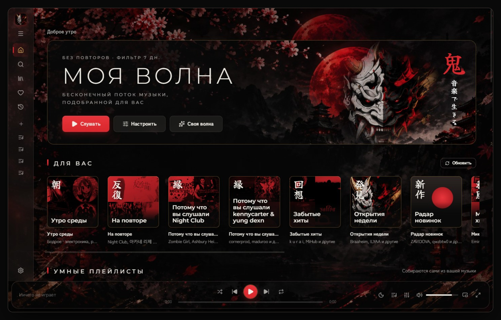

<sub>鬼 · 音楽で生きる — «живу музыкой»</sub>

</div>

<br>

<a name="features"></a>


<table>
  <tr>
    <td width="50%" valign="top">
      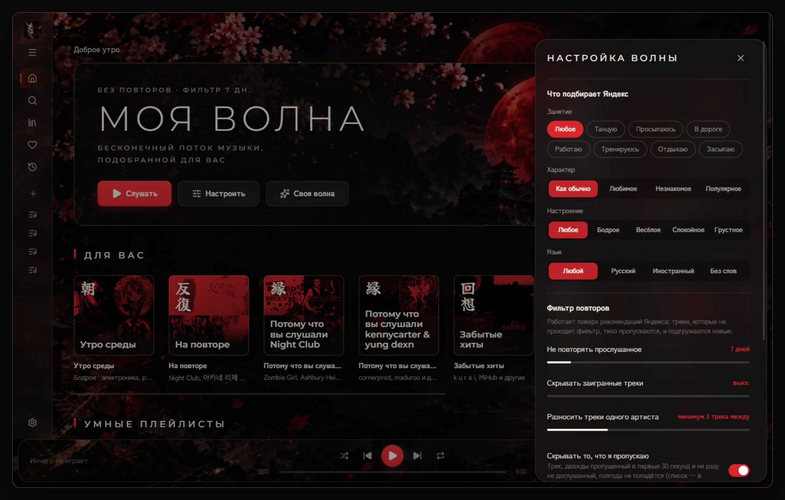
      <h3>Моя волна — без повторов</h3>
      Занятие, характер, настроение и язык — как у Яндекса. Сверху — свой фильтр: не повторять
      прослушанное за последние дни, разносить треки одного артиста, убирать то, что вы пропускаете.
      Рядом — <b>«Своя волна»</b>: станция только из вашей музыки — любимое, похожее, забытые хиты и новинки
      ваших исполнителей.
    </td>
    <td width="50%" valign="top">
      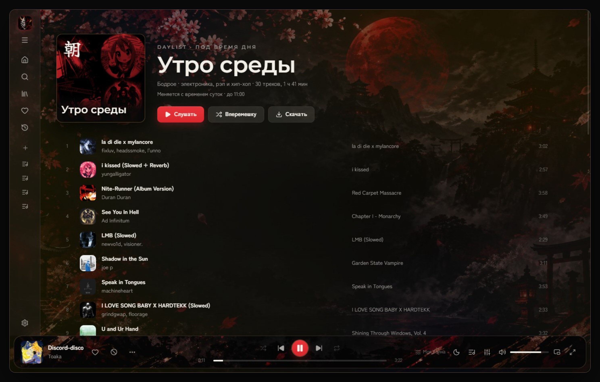
      <h3>Подборки в духе Spotify</h3>
      <b>Daylist</b> под время дня — утром бодрое, ночью тихое, меняется сам. «Открытия недели», «Радар
      новинок», «На повторе», «Забытые хиты», «Потому что вы слушали…» и миксы по жанрам — из ваших лайков
      и истории.
    </td>
  </tr>
  <tr>
    <td width="50%" valign="top">
      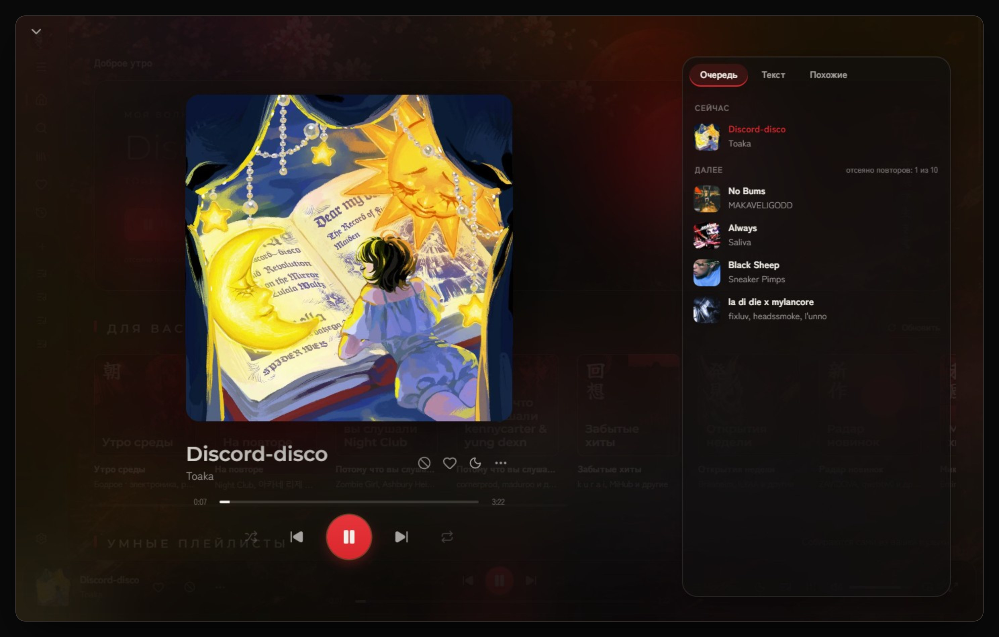
      <h3>Сейчас играет</h3>
      Большая обложка, очередь и похожие треки. Живые видеообложки Яндекса и пульс обложки на удар бочки.
      Умный кроссфейд и ровная громкость: тихое поднимается без искажений, альбом звучит одним уровнем.
    </td>
    <td width="50%" valign="top">
      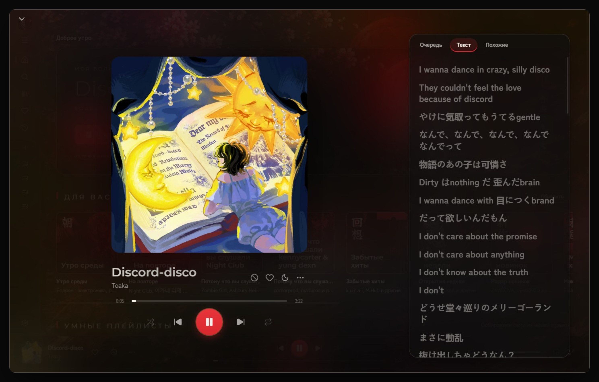
      <h3>Текст в такт</h3>
      Строка подсвечивается под голос. Нет текста у Яндекса — Oni найдёт его в LRCLIB на любом языке,
      а Genius откроет одной кнопкой.
    </td>
  </tr>
  <tr>
    <td width="50%" valign="top">
      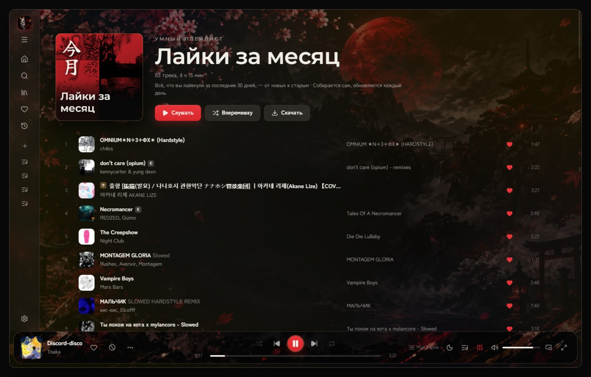
      <h3>Умные плейлисты</h3>
      Собираются сами из вашей музыки: «Лайки за месяц», «Новинки моих артистов», «Самое слушаемое»,
      «Лайки год назад». Обложки нарисованы кистью, как печати.
    </td>
    <td width="50%" valign="top">
      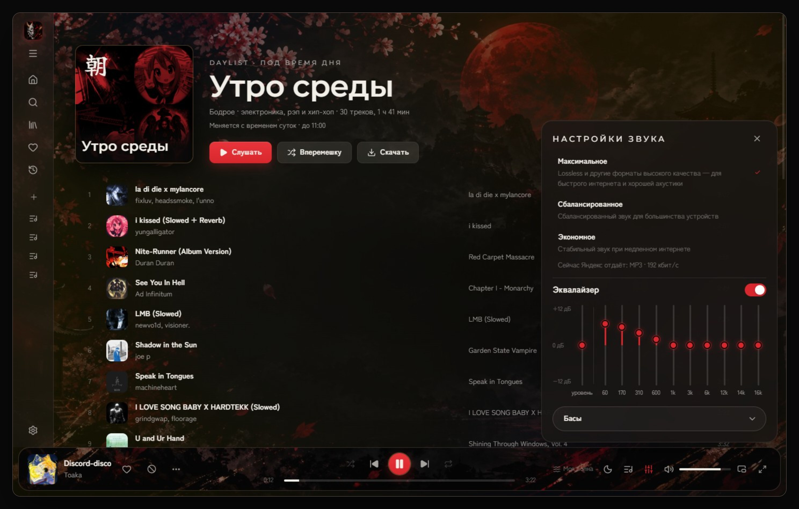
      <h3>Звук</h3>
      Качество звука и 10-полосный эквалайзер с пресетами — «Басы», «Голос», «Электроника» и ещё
      восемь, включая свой. На ПК и на iPhone звучит одинаково.
    </td>
  </tr>
  <tr>
    <td width="50%" valign="top">
      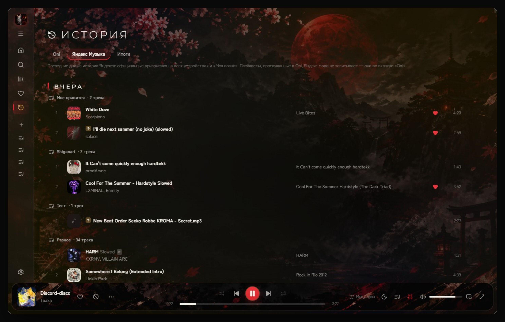
      <h3>История и «Итоги»</h3>
      Что вы слушали в Oni и в приложениях Яндекса — на всех устройствах. «Итоги» месяца и года —
      историями, как в сторис.
    </td>
    <td width="50%" valign="top">
      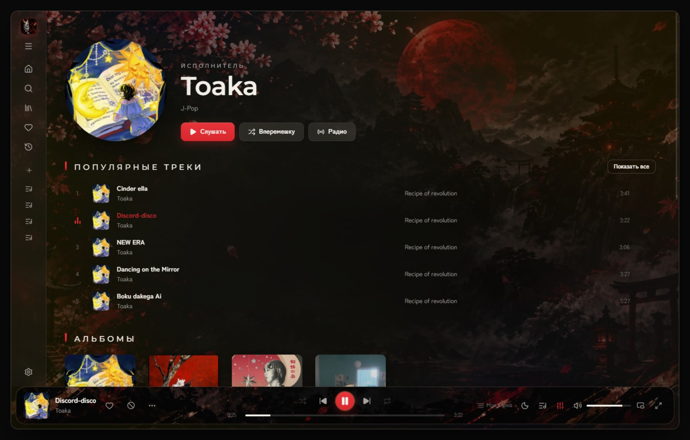
      <h3>Радио от чего угодно</h3>
      Бесконечный поток от трека, исполнителя, альбома или плейлиста — с тем же фильтром повторов,
      что и у волны.
    </td>
  </tr>
</table>

<table>
  <tr>
    <td width="44%" valign="middle">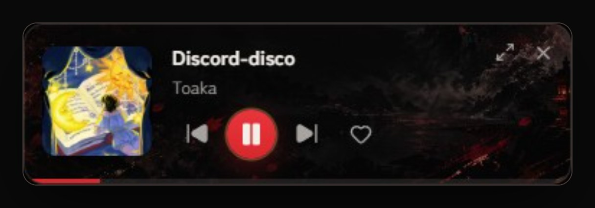</td>
    <td valign="middle">
      <h3>Мини-плеер и Windows</h3>
      Маленькое окно поверх остальных, кнопки в превью на панели задач, значок в трее, статус в Discord,
      боковые кнопки мыши — «назад / вперёд». Окно можно сделать полупрозрачным.
    </td>
  </tr>
</table>

**А ещё:**

- **Перенос плейлистов** из Spotify, Apple Music и YouTube — по ссылке, списком или файлом; Oni найдёт каждую
  песню в Яндекс Музыке и сам добавит те, что появятся позже.
- **Без сети** — как в Яндекс Музыке: скачанное играет в своих плейлистах, «Скачанное» — отдельной вкладкой.
  Скачанное остаётся, даже если Яндекс убрал трек.
- **Свои mp3** — в любой плейлист; друзья с Oni могут слушать и скачивать ваши загруженные треки.
- **Резервная копия на Яндекс Диске** — плейлисты с порядком треков, лайки и скачанное, две недели.
- «Пропущенное» уходит из подборок само, таймер сна, анимации в японском стиле, интерфейс на русском и английском.

<br>

<a name="iphone"></a>


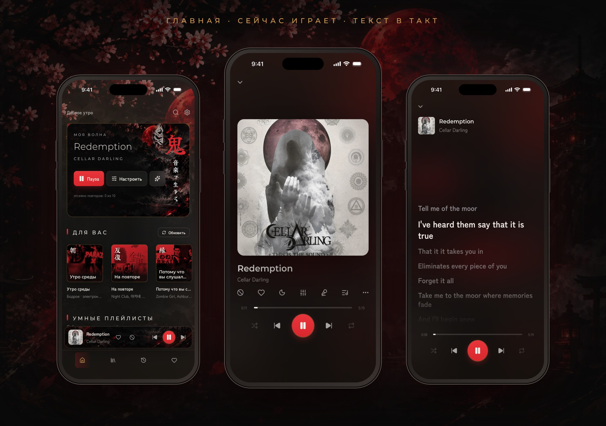

Oni на iPhone — не сайт в обёртке: музыку играет плеер самой iOS, с системным эквалайзером, в фоне и на экране
блокировки.

- **Виджеты** на экран «Домой» и блокировки — как плеер Пункта управления, в цветах Oni: обложка, ♥, кнопки.
- **Siri и «Команды»** — «Моя волна», пауза, дальше, «Лайкни трек в Oni».
- **Свайп по панели плеера** листает треки карусельной карточкой, свайп по «Коллекции» и «Истории» — вкладки.
- **Скачивание в фоне** со счётчиком на экране блокировки; без сети играет скачанное.

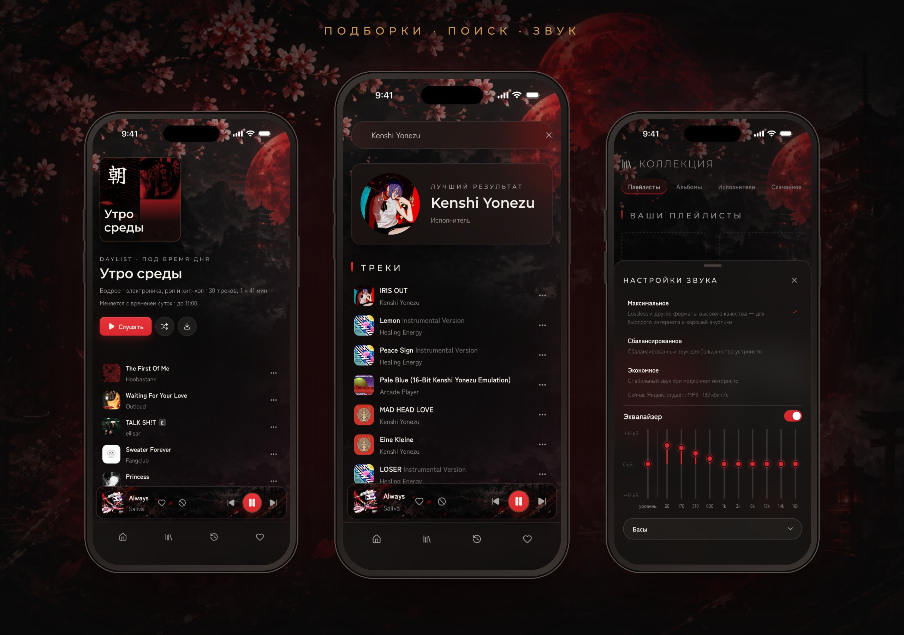

### Как поставить

App Store неофициальные клиенты не пропускает, поэтому Oni для iPhone ставится через
[SideStore](https://sidestore.io) — бесплатно, под вашим обычным Apple ID.

1. Установите SideStore по [инструкции на его сайте](https://sidestore.io). Для первой установки
   один раз понадобится компьютер.
2. iOS 16 и новее: «Настройки → Конфиденциальность и безопасность → Режим разработчика» →
   включить, перезагрузить телефон.
3. В SideStore: **Sources → +** и вставьте адрес
   ```
   https://raw.githubusercontent.com/D4SuCE/oni-releases/main/sidestore.json
   ```
   Затем Oni → **Install**.
4. Первый запуск: «Настройки → Основные → VPN и управление устройством» → доверять своему Apple ID.

Новые версии появляются в SideStore сами, а Oni сам скажет об обновлении и откроет SideStore. Подпись
с бесплатным Apple ID живёт 7 дней — SideStore продлевает её, когда вы его открываете (нужен интернет),
так что заглядывайте в него хотя бы раз в неделю.

<br>

<a name="devices"></a>


- **Пульт ПК ↔ iPhone.** Подключитесь с телефона к ПК (или наоборот) — и всё, что вы включаете, играет на
  том устройстве, которым управляете: плейлисты, подборки, «Моя волна» с её настройками, громкость. Дома связь
  идёт напрямую по сети, мгновенно; вне дома — через Яндекс Диск.
- **Общая история и «Пропущенное»** — через папку Oni на вашем Яндекс Диске. Своего сервера у Oni нет.

<br>

<a name="install"></a>


1. Скачайте **`Oni-Setup-<версия>.exe`** со страницы
   [последнего выпуска](https://github.com/D4SuCE/oni-releases/releases/latest) и запустите.
2. Windows может показать «Система Windows защитила ваш компьютер» — нажмите
   **«Подробнее» → «Выполнить в любом случае»**. У программы нет платной цифровой
   подписи, поэтому SmartScreen её пока не знает.
3. Войдите через Яндекс — под **своим** аккаунтом. Для полных треков нужна подписка
   Яндекс Плюс.

Не хотите устанавливать — есть **`Oni-<версия>-portable.exe`**: один файл, работает
без установки.

<br>

<a name="updates"></a>


Установленная программа обновляется сама: проверяет новые версии при запуске,
скачивает их в фоне и ставит при выходе. Когда обновление готово, на шестерёнке
настроек появляется красная точка, а в «Настройки → О приложении» — кнопка
«Перезапустить и обновить».

Portable-версию нужно обновлять вручную — в её настройках есть ссылка сюда.
Что изменилось в каждой версии — в описании [выпусков](https://github.com/D4SuCE/oni-releases/releases).

<br>

<a name="faq"></a>


<details>
<summary><b>Это безопасно? Куда уходят данные моего аккаунта?</b></summary>
<br>

Вход — через страницу Яндекса, программа получает только токен доступа к музыке.
На компьютере он хранится в зашифрованном виде (средствами Windows), у каждого
пользователя Windows — свой; на iPhone — в связке ключей. Oni обращается только к серверам
Яндекса (Музыка и, если вы подключите, Диск), к LRCLIB за текстами песен и к GitHub — за обновлениями.

</details>

<details>
<summary><b>Почему звук в MP3 192 кбит/с, если выбрано «Максимальное»?</b></summary>
<br>

Качество выдаёт Яндекс, и некоторым аккаунтам он на любой запрос отдаёт MP3 192 кбит/с.
Панель звука показывает, что на самом деле играет.

</details>

<details>
<summary><b>Можно без Плюса?</b></summary>
<br>

Войти можно, но без подписки Яндекс отдаёт только 30-секундные фрагменты треков.

</details>

<details>
<summary><b>Зачем подключать Яндекс Диск?</b></summary>
<br>

Необязательно. С Диском Oni хранит в своей папке «Приложения/Oni» общую историю устройств, резервные копии
и ваши загруженные треки для друзей, а пульт работает и вне дома. Доступ — только к этой папке.

</details>

<details>
<summary><b>Как удалить?</b></summary>
<br>

«Параметры → Приложения → Oni → Удалить». Portable-версию достаточно удалить как файл.
На iPhone — как любое приложение: долгое нажатие на значок → «Удалить приложение».

</details>

<br>

<div align="center">
<br>
<sub>Oni — неофициальный клиент и не связан с Яндексом.</sub>
</div>
